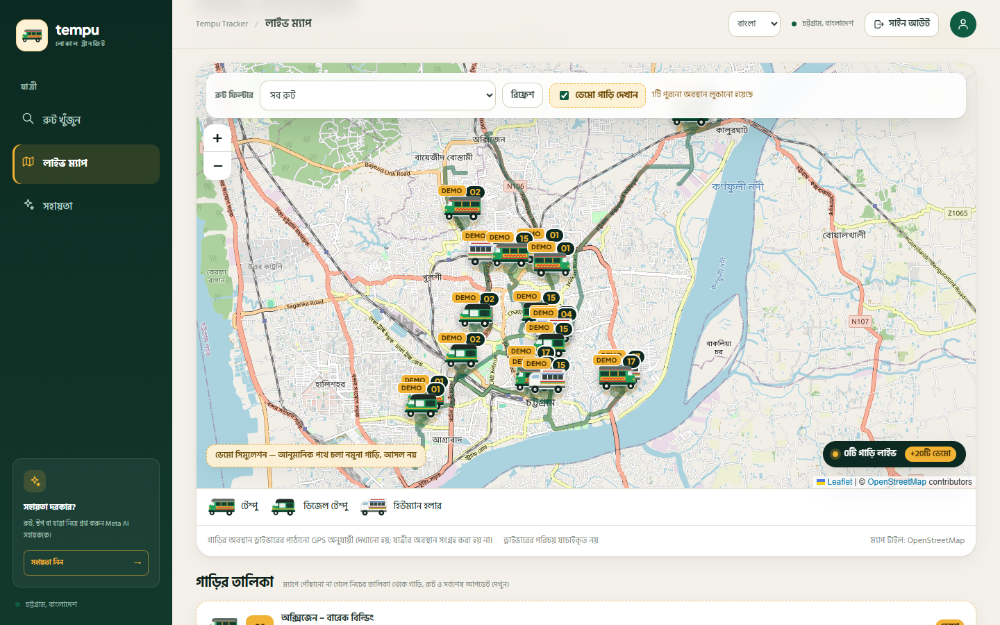
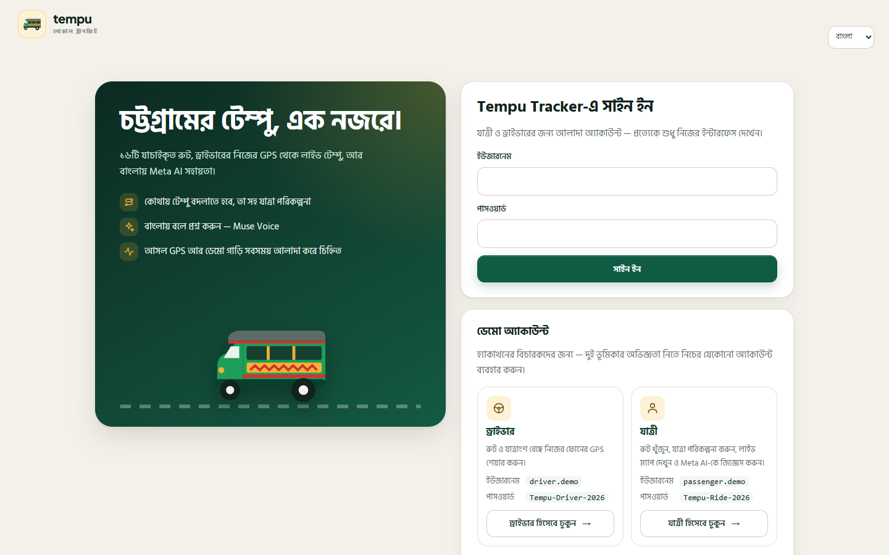
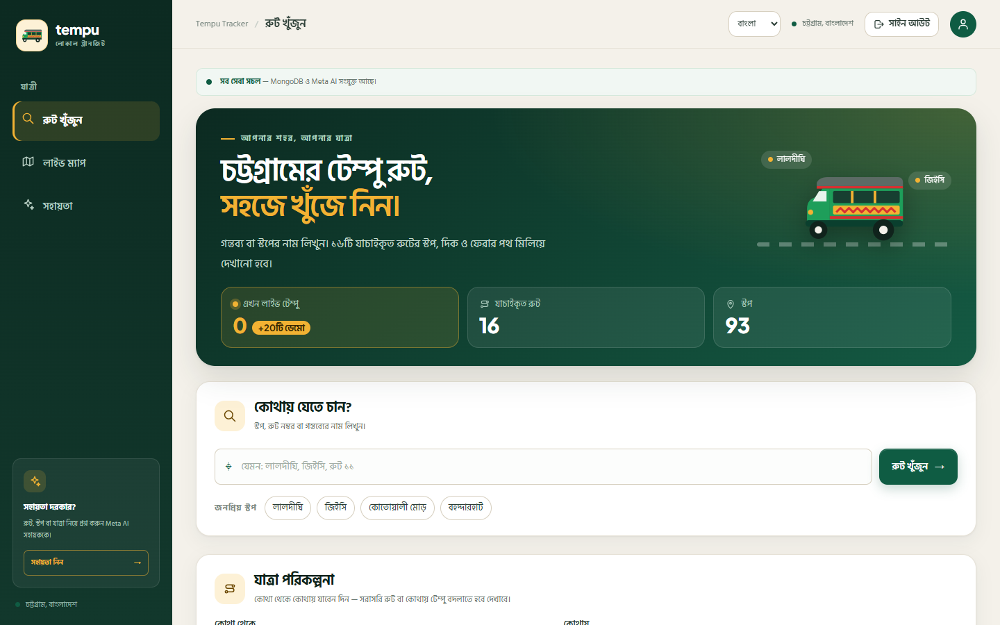
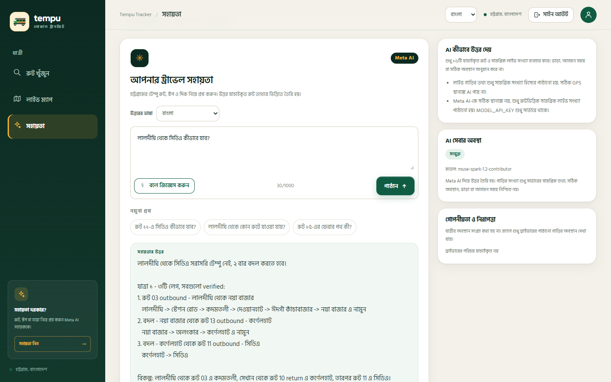
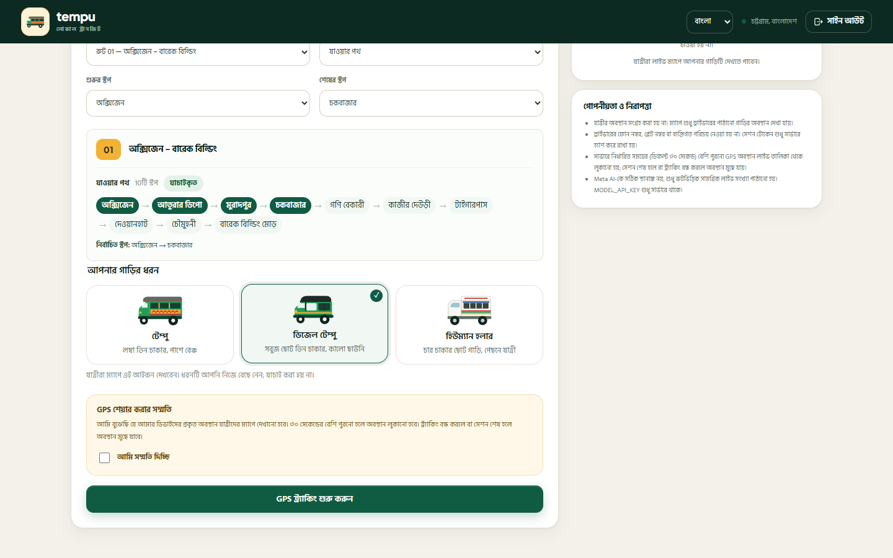
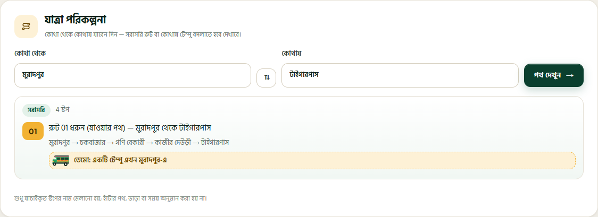
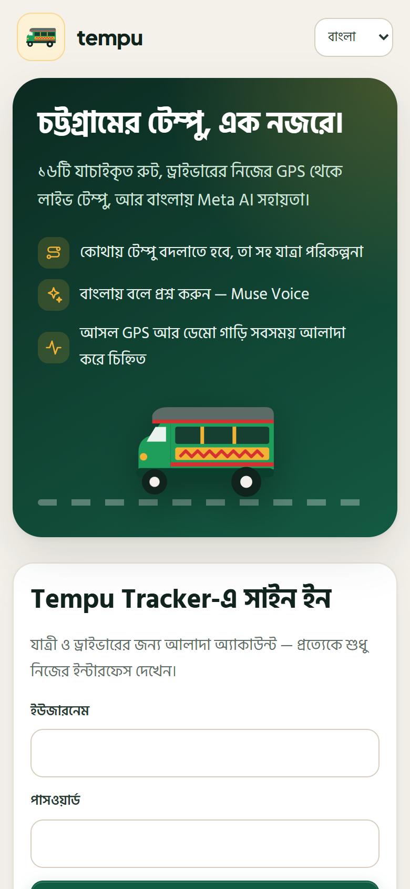
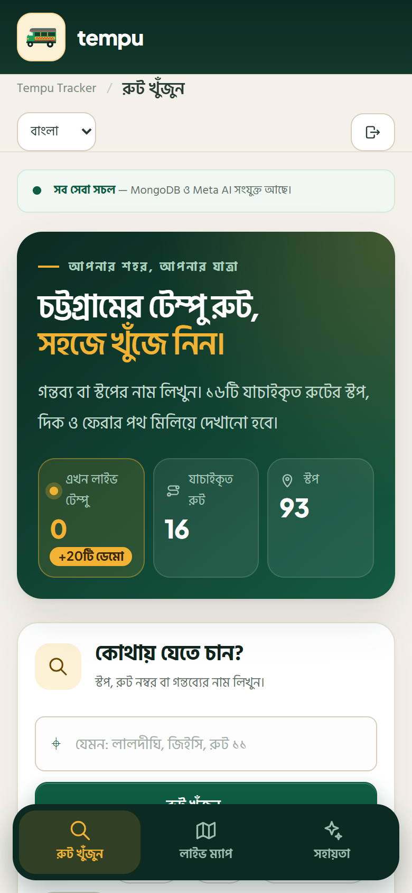
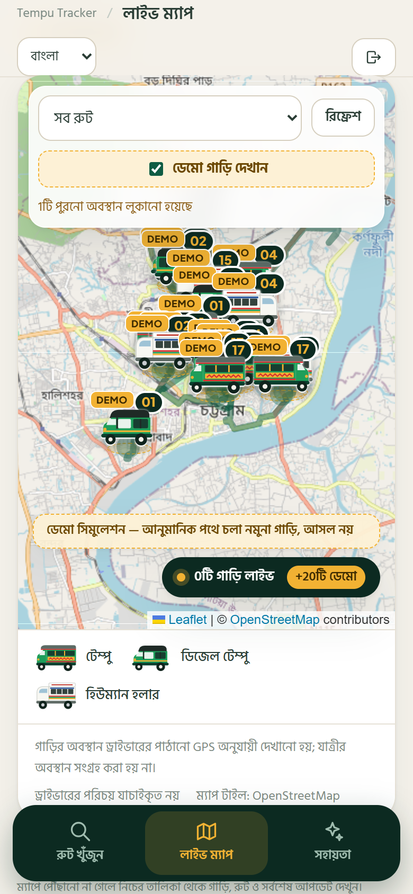
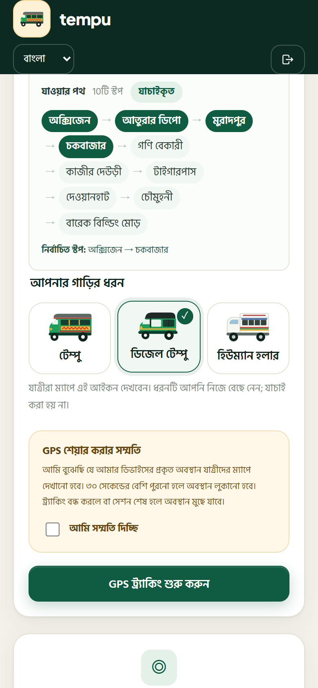

# Tempu Tracker

**Chattogram's verified tempu routes, driver-shared live GPS, and a Meta AI travel assistant.**

Tempu Tracker is a Bangla-first web app built for the Meta AI Developer Hackathon 2026. It combines a canonical dataset of 16 Chattogram tempu routes with genuine browser/device GPS sharing by drivers and a route-grounded AI assistant.

## Live demo

- **App:** https://tempu-tracker-client.vercel.app
- **API health:** https://tempu-tracker-server.vercel.app/api/health (MongoDB Atlas connected, persistent; Meta AI configured with `muse-spark-1.2-contributor`)

### Demo accounts

Sign in on the first screen. Each role sees only its own interface.

| Role | Username | Password | What it opens |
| --- | --- | --- | --- |
| Driver | `driver.demo` | `Tempu-Driver-2026` | Driver tracking interface and a read-only live map |
| Passenger | `passenger.demo` | `Tempu-Ride-2026` | Route search, trip planner, live map, Meta AI assistant with voice |

The login page also has one-click buttons for both accounts. These are public demo credentials: there is no sign-up and driver identity is not verified.

No real drivers are registered yet, so the map shows a labelled demo fleet (tagged DEMO). To see a real vehicle as well, sign in as the driver on a phone, start tracking, and open the live map as the passenger on a second device: the phone's pin appears without the DEMO tag.

> This is a working hackathon prototype, not a production transport service. Driver identity and vehicle documents are **not** verified. Real positions exist only while a driver deliberately shares device GPS. For the hackathon demo, signed-in users also see simulated vehicles; every one is tagged DEMO, drawn with a dashed border, and can be switched off.



## What is implemented

- **16 verified routes** (`01`–`08`, `10`–`17`) with exact stop names and order. Route `09` is intentionally absent.
- **Outbound and return directions**, including explicit returns and `একই পথে` reversal. Route 15's return tail is marked **partially inferred** and `আবদুস সাত্তার রোড` is treated as a via-road, not a stop.
- **Deterministic route search** by stop, route number, or route name, with Bangla digit normalization and distinct `একে খান মোড়` / `একে খান গেট` handling.
- **Driver flow**: route → direction → valid partial start/end, explicit GPS consent, one genuine browser GPS fix to start, then a throttled `watchPosition` stream.
- **Multi-vehicle live map**: separate sessions, route filter, server timestamps, stale filtering, live/empty/loading/offline/error states, accessible vehicle list.
- **MongoDB persistence when configured**: official driver, JSON schema validation, unique indexes, TTL expiry, and session isolation. Without a URI, the app runs in an explicitly labelled non-persistent memory mode.
- **Meta AI assistant**: backend-only `MODEL_API_KEY`, verified `https://api.meta.ai/v1`, model `muse-spark-1.2-contributor` (pinned in `server/config.ts`), grounded prompt using verified routes and aggregate live counts only. AI and tracking fail independently.
- **Trip planner with changes**: pick a start and destination stop and get direct rides or journeys with up to two changes between routes, naming the exact change stop and each leg's direction. It is deterministic (`shared/trip.ts`), runs in the browser, and never invents stops, walking links, fares, or times.
- **Muse Spark tool calling**: the assistant is given two read-only tools, `plan_trip` and `find_stop`, over the verified dataset and can call them for up to three rounds before answering. The UI shows which tools were used. If the provider rejects function tools, the assistant automatically falls back to the grounded prompt.
- **Voice questions with Muse Voice**: press **বলে জিজ্ঞেস করুন**, speak a question (up to 20 s), and the server streams it as 16 kHz PCM16 to `muse-voice-transcribe-1.0` over Meta's realtime ASR socket with a Bengali language bias. The transcript fills the question box for the user to check before sending. Audio is never stored.
- **Privacy controls**: no phone, plate, driver identity, or passenger location is collected. Session tokens are returned once, stored hashed, sent only in a Bearer header, and removed on stop/expiry.
- **Bangla/English UI**, experimental Chittagonian AI answer option (with standard Bangla fallback), responsive layout, keyboard focus, skip link, reduced-motion support.
- **Labelled demo fleet**: because no real drivers are registered yet, signed-in users see 20 simulated vehicles (two per direction on routes 01, 02, 04, 15 and 17) driving along real streets from the first stop to the last (road paths built once from OpenStreetMap routing by `server/scripts/build-demo-paths.ts` and stored in `src/lib/demoPaths.json`; the app never calls a routing service at runtime). Each vehicle faces its direction of travel, and the routes are drawn on the map. They are computed in the browser from the clock, never sent to the server or the AI, carry a dashed border and a DEMO tag, and can be switched off with **ডেমো গাড়ি দেখান**. The trip planner shows how many stops away the next demo vehicle is. Real driver GPS still appears alongside them without the tag.
- **Three vehicle types with their own icons**: drivers pick what they drive — **টেম্পু** (long three-wheeler with side benches), **ডিজেল টেম্পু** (diesel tempu), or **হিউম্যান হলার** (four-wheel human hauler). The live map pin, vehicle list and legend show the matching icon. The type is driver-declared and not verified; sessions without one default to টেম্পু.
- **Separate driver and passenger sign-in**: a login page with two demo accounts. A passenger only sees search, the trip planner, the live map and the assistant; a driver only sees the tracking interface and a read-only live map. The server enforces the same split: only a driver token can start GPS sharing, and only a passenger token can use the AI and voice endpoints. Tokens are HMAC-signed, expire after 12 hours, and are sent in an `X-Tempu-Auth` header.
- **Automated tests** for routes, journeys, GPS validation, session isolation, store/AI outages, AI failure mapping, privacy, search, freshness, and the frontend API client.

## Screens

Screenshots of the live site at https://tempu-tracker-client.vercel.app (Bangla interface), captured with headless Chrome on 4 November 2026.

### Desktop

| Login with demo accounts | Passenger home |
| --- | --- |
|  |  |

| Live map — three vehicle types on real streets | Meta AI assistant — Muse Spark used `plan_trip` |
| --- | --- |
|  |  |

| Driver tracking — route, segment, vehicle type, consent |
| --- |
|  |

**Trip planner** — Muradpur → Tiger Pass on route 01, with a live demo-vehicle hint:



### Mobile (390 × 844)

| Login | Passenger home | Live map | Driver |
| --- | --- | --- | --- |
|  |  |  |  |

## Quick start

### Prerequisites

- Node.js **22+** (tested with Node 24.18.0)
- npm
- Optional: a MongoDB Atlas Free connection string
- Optional: a Meta Model API key with access to `muse-spark-1.2-contributor`

### 1. Install

```powershell
cd "E:\Meta Hackathon 2026\tempu-tracker"
npm install
cd server
npm install
cd ..
```

### 2. Configure the backend

```powershell
Copy-Item server/.env.example server/.env
```

Edit `server/.env`:

```dotenv
PORT=3001
MONGODB_URI=              # optional; leave blank for labelled memory mode
MONGODB_DB_NAME=tempu_tracker
MODEL_API_KEY=            # backend only; never put this in a VITE_* variable
META_BASE_URL=https://api.meta.ai/v1
META_MODEL=muse-spark-1.2-contributor
```

`server/.env` is ignored by Git. Never commit it or paste its contents into a public issue.

### 3. Optional frontend environment

For local development the frontend calls relative `/api` URLs and Vite proxies them to `http://localhost:3001`. No `.env` is required.

For a separately hosted backend:

```powershell
Copy-Item .env.example .env
```

Set `VITE_API_BASE_URL=https://your-api.example.com` and rebuild. `VITE_*` values are public; never put a secret there.

### 4. Run

Terminal 1:

```powershell
cd server
npm run dev
```

Terminal 2:

```powershell
npm run dev
```

Open `http://localhost:5173`.

Useful deep links:

- Passenger dashboard (default): `http://localhost:5173/#/explore`
- Full live map: `http://localhost:5173/#/map`
- Assistant: `http://localhost:5173/#/assistant`
- Driver interface: `http://localhost:5173/#/driver`

Which interface a link opens depends on the signed-in role: a passenger opening `#/driver` stays on the passenger dashboard, and a driver opening a passenger link stays in the driver interface.

The driver's **Open live map in a new tab** button keeps the driver tab alive so the GPS watch is not unmounted.

### 5. Verify Meta access without inference

```powershell
cd server
npm run verify:meta
```

This performs an authenticated model-list request only and does **not** generate an answer. To run one short inference call (may consume provider credits):

```powershell
npm run verify:meta -- --infer
```

Only do this with approval to spend provider credits.

## Deploying to Vercel

The API and client are two Vercel projects deployed from the CLI.

```powershell
# API: stage a self-contained copy (vendors shared/, adds .js imports, server.ts entry)
cd server
node scripts/stage-vercel.mjs
cd .vercel-deploy
vercel deploy --prod --project tempu-tracker-server

# Client: from the repo root (.vercelignore keeps server/ and secrets out of the upload)
vercel deploy --prod --project tempu-tracker-client --build-env VITE_API_BASE_URL=https://tempu-tracker-server.vercel.app
```

Server secrets (`MODEL_API_KEY`, `MONGODB_URI`, `CORS_ORIGINS`) live in the Vercel project settings, never in the uploaded files.

## Data modes

| Condition | Mode | Behaviour |
| --- | --- | --- |
| `MONGODB_URI` set and reachable | `mongodb` | Persistent sessions, indexes, TTL retention |
| `MONGODB_URI` blank | `memory` | Non-persistent; clearly labelled in UI and health |
| MongoDB configured but unreachable, `MONGODB_REQUIRED=false` | `memory-fallback` | Non-persistent fallback; clearly labelled |
| MongoDB required and unavailable | `unavailable` | Tracking endpoints return `503`; AI can still work |

The frontend reads `/api/health` and shows a memory-mode or database-down banner. It does not present memory data as durable.

### MongoDB persistence setup

The deployed API (`tempu-tracker-server.vercel.app`) runs against MongoDB Atlas and reports `mode: "mongodb", persistent: true`. Without a `MONGODB_URI` the app truthfully runs in memory mode. To enable persistence:

1. Create a **MongoDB Atlas Free** cluster (or use another MongoDB deployment).
2. In **Database Access**, create a database user with a strong password.
3. In **Network Access**, allow your current public IP (and your deployment's egress IP later).
4. Copy the connection string from Atlas.
5. Add it to `server/.env` locally:
   ```dotenv
   MONGODB_URI=mongodb+srv://<user>:<password>@<cluster>.mongodb.net/?retryWrites=true&w=majority
   MONGODB_DB_NAME=tempu_tracker
   MONGODB_REQUIRED=false
   ```
6. Restart the backend and check `http://localhost:3001/api/health`. A successful setup reports:
   ```json
   "database": { "configured": true, "connected": true, "mode": "mongodb", "persistent": true }
   ```
7. Start a driver session, then verify persistence by updating its location, restarting the backend, and confirming the active vehicle is still returned (if it is still inside the 30-second freshness window). The integration test requires a **test-only** URI:
   ```powershell
   $env:MONGODB_URI_TEST="mongodb+srv://<test-user>:<password>@<test-cluster>/..."
   $env:MONGODB_DB_NAME_TEST="tempu_tracker_test"
   cd server
   npm test
   ```

Never commit `server/.env` or paste the connection string into an issue. If MongoDB is blank or unreachable, the UI keeps showing an explicit memory / memory-fallback warning.

## API

| Method | Path | Purpose |
| --- | --- | --- |
| `POST` | `/api/auth/login` | Demo sign-in; returns a signed token, the user's role, and expiry |
| `GET` | `/api/auth/me` | Check the `X-Tempu-Auth` token |
| `GET` | `/api/health` | Separate database and AI health, no secrets |
| `GET` | `/api/health/ready` | Readiness (`503` only when tracking is unavailable) |
| `GET` | `/api/tracking/active?routeNumber=01` | Fresh public vehicle positions and stale count |
| `POST` | `/api/tracking/start` | Validate journey, consent, initial GPS; create session. Optional `vehicleType`: `tempu` (default), `diesel-tempu`, or `human-hauler`. |
| `POST` | `/api/tracking/location` | Update one session using `Authorization: Bearer <token>` |
| `POST` | `/api/tracking/stop` | Delete the session (idempotent `204`) |
| `POST` | `/api/ai-test` | Route-grounded Meta AI answer; returns `toolCalls` used |
| `POST` | `/api/transcribe?language=bn` | 16 kHz mono PCM16 (`application/octet-stream`, ≤ 20 s) → Muse Voice transcript |

All API responses use structured error codes such as `INVALID_JOURNEY`, `CONSENT_REQUIRED`, `UNAUTHORIZED_SESSION`, `UPDATE_TOO_FREQUENT`, `TRACKING_STORE_UNAVAILABLE`, and `AI_NOT_CONFIGURED`.

## Tests and checks

```powershell
# Frontend
npm test
npm run build
npm run lint

# Backend
cd server
npm run typecheck
npm test
```

Current local result (3 Nov 2026):

- Frontend: **20/20 tests passed**, build passed, lint clean.
- Backend: **74 tests, 73 passed, 1 skipped** (MongoDB integration requires `MONGODB_URI_TEST`). New tests cover the trip planner, route tools, the tool-call loop and its fallback, the Muse Voice handshake and packet streaming (with a fake socket), the transcribe endpoint, and sign-in with role checks (driver-only GPS start, passenger-only AI, tampered and expired tokens).
- Role separation: both demo accounts checked in the browser; a passenger opening `#/driver` stays on the passenger dashboard and gets `403` from the GPS start endpoint; a driver opening passenger links stays in the driver interface and gets `403` from the AI endpoint. Login page checked at 375 px with no horizontal overflow.
- Database: local checks ran in **memory mode**. The deployed API is connected to MongoDB Atlas (persistent); the automated Atlas integration test is still skipped until a test-only `MONGODB_URI_TEST` is provided.
- Dependency audit: **0 vulnerabilities** after updating Capacitor CLI tooling.
- Meta model listing: authenticated, 9 models visible, `muse-spark-1.2-contributor` (the pinned model) present; **no inference call made** during automated checks.

See [TEST_REPORT.md](docs/TEST_REPORT.md) for exact output and untested areas.

## Documentation

- [Architecture](docs/ARCHITECTURE.md)
- [Privacy and security](docs/PRIVACY_AND_SECURITY.md)
- [Test report](docs/TEST_REPORT.md)
- [Requirements checklist](docs/REQUIREMENTS_CHECKLIST.md)
- [Demo script](docs/DEMO_SCRIPT.md)
- [3-minute video script](docs/DEMO_VIDEO_SCRIPT.md)
- [Known limitations](docs/KNOWN_LIMITATIONS.md)

## Important limitations

- The 16-route dataset comes from the supplied hackathon route list; it has not been independently field-verified. Route 15's return tail awaits owner confirmation.
- Driver identity, phone number, and vehicle documents are not verified. Route and journey are self-declared.
- Browser GPS can be spoofed by a determined user; the server validates format, range, rate, and session isolation, not physical presence.
- No fare, ETA, passenger account, demand insight, or background tracking.
- MongoDB integration and real Meta inference are not covered by the default automated test run.
- Android APK build is not verified in this environment (Java/`ANDROID_HOME` missing). Location and internet permissions have been added to the manifest.

## License

No license has been declared yet. Add one only after the hackathon's IP and submission rules are confirmed.
